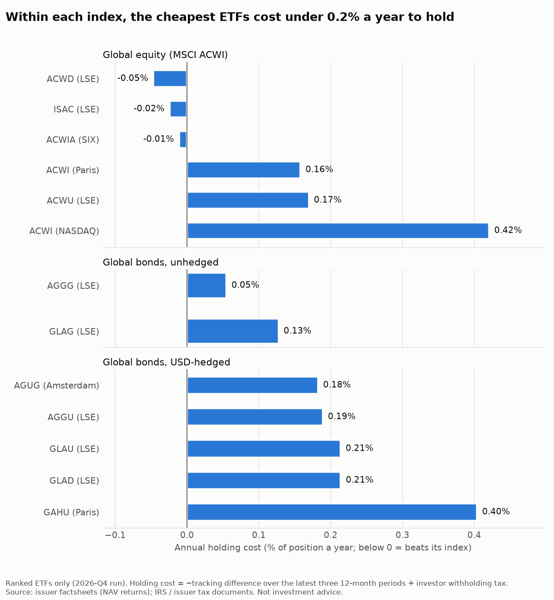
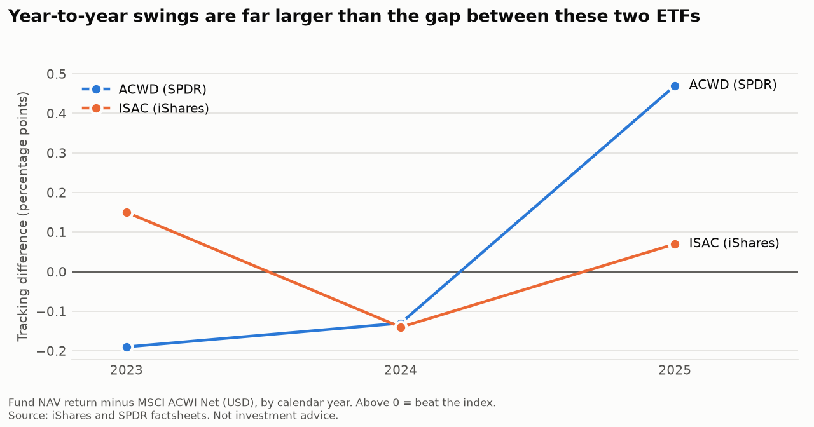

# ETF Vehicle Selection

> **One line:** A quarterly tool that ranks every ETF tracking MSCI ACWI and the Bloomberg Global Aggregate by what it actually costs a Singapore tax resident to hold, and flags when switching would pay for itself.


## Summary

| | |
|---|---|
| **Question** | Each quarter: which ETF is the cheapest way to hold each index, and should a current holding be switched? |
| **Universe / period** | 24 share classes tracking MSCI ACWI (global equity) or the Bloomberg Global Aggregate (global bonds, unhedged and USD-hedged); each fund's latest three 12-month periods, mostly calendar years 2023–2025; USD base, SGD shown alongside |
| **Method** | Annual holding cost = expense ratio + tax withheld on distributions for a Singapore resident, both fixed, published figures. Funds are ranked within each index version. A switch is flagged only if the saving over the rest of a 20-year horizon exceeds the cost of switching, including any earlier switch not yet paid back. Tracking difference (how far each fund actually lagged its index) is reported alongside but not used to rank |
| **Headline result** | 2026-Q4 run: the cheapest global equity ETF costs **0.12% a year** (ACWD), and every eligible global bond ETF costs **0.10%**, hedged or not. The US-listed ACWI costs **0.75%**, of which 0.43% is US withholding tax |
| **Status** | In progress |

## Key findings



1. **Where a fund is domiciled matters more than its fee.** The US-listed ACWI charges 0.32%, but the US also withholds 30% of its distributions, about 0.43% a year, taking the total to 0.75%: more than six times the cheapest Irish fund (0.12%). Irish-domiciled funds pay no tax on distributions to a Singapore resident. The US fund also exposes holdings above USD 60,000 to US estate tax.
2. **Global bond ETFs can't be separated on cost.** Every eligible Bloomberg Global Aggregate fund charges 0.10%, hedged or unhedged, so they tie. Their measured tracking difference does differ (−0.05% to −0.40% a year), but see finding 3.
3. **Surprise: measured tracking difference is too noisy to rank funds on.** The two cheapest ACWI funds differ by 0.023% a year on average, but each one's yearly tracking difference moves by up to 0.66 percentage points. Three years of data can't tell them apart, which is why the ranking uses fixed, published costs instead.

   

The full ranking, including funds too new to rank and the near-equivalents VWRA and VAGU, is in [reports/2026-Q4/ranking.md](reports/2026-Q4/ranking.md). Every rule and the evidence behind it is in [docs/decisions.md](docs/decisions.md).

## Limitations

- **Fixed costs only.** The ranking leaves out costs and gains that show up only in tracking difference: tax withheld inside the fund, securities-lending income, swap costs and sampling error. Funds with equal fees tie even if one consistently tracks better. Three years of tracking difference (the reported figure) are too few to measure these reliably.
- **Windows differ slightly.** Most issuers publish calendar years; UBS and HSBC publish 12-month periods to September, so their figures cover a window shifted by nine months. This is shown, not adjusted.
- **Annual, not daily.** Free daily index data exists only for MSCI ACWI, and daily market prices proved too noisy: a London ETF closes hours before the index does. Tracking difference therefore comes from issuers' calendar-year NAV figures, and each new year enters only in January.
- **Spreads are mostly assumed.** A published median spread was found only for the US-listed ACWI (0.01%). The high-low estimator tried first overstated it eighteenfold, so the other funds use a conservative 0.10%, which makes switching look slightly more expensive than it is.
- **Candidate list maintained by hand.** New ETFs appear only once added. 16 of 24 share classes are verified against issuer documents; most of the rest are under a year old and unranked.
- **Some tax inputs rest on secondary sources.** The US 30% and Irish 0% withholding rates still need checking against IRS Publication 515 and IRAS guidance.

## Reproduce it

Requires [uv](https://docs.astral.sh/uv/) (installs Python for you).

```bash
git clone https://github.com/azrinmahsuom/ETF-vehicle-selection.git
cd ETF-vehicle-selection
uv sync                  # create the environment
uv run pytest            # check everything works
uv run python -m analysis.pipeline   # download prices, rebuild the ranking and charts
```

The ranking and charts come from the committed files in `reference/` plus prices downloaded at run time. The personal switch review also needs holdings in `data/external/` (`portfolio.toml`, `holdings.csv`, `switch_log.csv`), which are not committed; without them the pipeline skips that step.

## Repository layout

```
├── AGENTS.md          Rules for AI coding agents working in this repo (CLAUDE.md points here)
├── data/              Downloads and personal inputs (not committed; created by the code)
├── docs/              Project brief and methodology decision log
├── notebooks/         Exploration only; anything reusable moves to src/
├── reference/         Hand-researched inputs with sources (candidates, returns, tax rates, broker fees)
├── reports/           Quarterly rankings and figures (committed)
├── src/analysis/      Reusable code: downloads, cost model, ranking, charts, pipeline
└── tests/             Tests for the code in src/
```

## Data sources

| Source | What | Licence / terms |
|---|---|---|
| Issuer factsheets (iShares, SPDR, Amundi, UBS, HSBC, Vanguard) | Calendar-year NAV and benchmark returns, expense ratios, launch dates | Public documents; each row cites its source in `reference/` |
| Yahoo Finance via yfinance | Daily ETF prices and distributions, USD/SGD and EUR/USD rates | Personal, non-commercial use |
| MSCI end-of-day index data | MSCI ACWI Net (USD) daily levels, used to test the daily approach | Informational, non-commercial use; not redistributed |
| IBKR Singapore pricing pages | Pro Tiered commissions and FX fees | Public |
| Tax treaty summaries; Amundi prospectus | Withholding on distributions by fund domicile | Public |
| justETF | First-pass candidate list and listings | Public; replaced by issuer documents where verified |

## Disclaimer

This is a personal research project built on publicly available data. It is not investment advice, not a recommendation to buy or sell any security, and does not represent the views of any employer.
